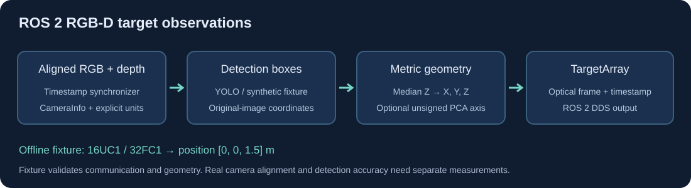

# ROS 2 RGB-D Perception · 目标检测与三维定位原型

基于本地 ROS 2 / YOLOv5 视觉实验整理的感知应用：
**同步彩色与已配准深度图 → 目标检测 → 米制反投影 → ROI 点云主轴估计 → 带时间戳的目标消息**。

目标环境：Ubuntu 24.04、ROS 2 Jazzy、Python 3.12。
保留 YOLOv5 接入方式，另提供 Ultralytics 模型适配器和不需要模型/相机的合成演示。
本项目是学习与工程集成原型，没有宣称完整机器人闭环、真实相机定位精度或完整 6DoF 姿态。



## 快速体验：无硬件、无模型演示

安装好 ROS 2 Jazzy、rosdep 和 colcon 后：

```bash
git clone https://github.com/addrun/ros2-rgbd-perception.git
cd ros2-rgbd-perception
source /opt/ros/jazzy/setup.bash
rosdep update
rosdep install --from-paths src --ignore-src --rosdistro jazzy -r -y
colcon build --symlink-install
source install/setup.bash
ros2 launch rgbd_perception perception.launch.py demo:=true
```

若 rosdep 尚未初始化，先运行一次 `sudo rosdep init`。
另开终端 source ROS 和工作空间后观察：

```bash
ros2 topic echo /targets
```

合成场景为 640×480 图像、已知矩形框和 1.5 m 平面。
输出标签为 `synthetic_target`，位置接近 `[0, 0, 1.5]`，坐标系为 `demo_color_optical_frame`。
**fixture 后端直接提供已知框，不运行 YOLO；该演示验证 ROS 通信和几何链路，不验证目标检测性能。**

同一场景也支持米制浮点深度：

```bash
ros2 launch rgbd_perception perception.launch.py demo:=true depth_encoding:=32FC1
```

## 真实检测输入

启动所用相机驱动，并提供下表输入。驱动与标定不包含在本仓库中。

| 输入 | 默认话题 | 约束 |
| --- | --- | --- |
| 彩色 Image | `/camera/color/image_rect` | 无畸变 BGR 可转换图像 |
| 深度 Image | `/camera/aligned_depth/image_raw` | 已配准到上述彩色图；`16UC1` 毫米或 `32FC1` 米 |
| CameraInfo | `/camera/color/camera_info` | 对应该图像的 K；尺寸、光学 frame 一致；D=0、R=I、P 的平移列为 0 |

此版本仅支持上述无畸变、单相机光学几何约定。它不会自己完成深度配准、去畸变或跨相机外参变换。
CameraInfo 缓存为静态标定；彩色和深度使用近似时间同步，默认最大差 0.03 秒、SensorData QoS。
如果相机驱动提供其他话题/标定形式，应先在驱动或预处理端得到相符输入。

### Ultralytics 后端

将兼容的 `ultralytics` / PyTorch 安装到运行 ROS 节点的同一 Python 环境。
建议为真实模型创建基于系统 Python 的独立环境，保留 ROS 的系统依赖；不要把整个 Conda 环境复制到仓库。

```bash
sudo apt install python3-venv
python3 -m venv --system-site-packages .venv
source .venv/bin/activate
pip install 'numpy<2' 'ultralytics>=8.3,<9'
touch .venv/COLCON_IGNORE
# colcon 生成的入口可能固定使用 /usr/bin/python3；直接用该环境解释器运行模块：
python -m rgbd_perception.node --ros-args \
  --params-file src/rgbd_perception/config/detector.yaml \
  -p model_path:=/absolute/path/to/yolo11n.pt
```

节点模块支持 `python -m`。配置文件可修改话题、同步窗口、深度范围和置信度阈值。
如果模型依赖已安装在 ROS 节点的系统解释器中，也可以：

```bash
ros2 launch rgbd_perception perception.launch.py model:=/absolute/path/to/yolo11n.pt
```

本机已对现有 YOLO11n 权重做过 CPU 推理适配器检查，具体范围见验证记录。
不会自动下载权重，也不将预训练模型认作个人训练成果。

### 兼容已有 YOLOv5 实验

提供与自身权重相匹配的上游 YOLOv5 checkout 和运行依赖：

```bash
ros2 launch rgbd_perception perception.launch.py backend:=yolov5 \
  yolov5_repo:=/absolute/path/to/yolov5 model:=/absolute/path/to/best.pt
```

YOLOv5 适配器在推理后只还原一次检测框坐标；当前默认 CPU。
该接口保留原实验接入路径，未承诺所有历史权重/PyTorch 版本均兼容。

## 几何与消息

```text
16UC1 → 深度 × 0.001；32FC1 → 保持米制
剔除无效深度 / 框边缘 → ROI 中位数 Z
X = (u - cx) × Z / fx；Y = (v - cy) × Z / fy
ROI 深度反投影为局部点云 → PCA 主轴（最多约 2000 点）
```

输出 `/targets`，类型 `rgbd_interfaces/TargetArray`：

- Header 沿用彩色输入的时间戳和光学坐标系，X 向右、Y 向下、Z 向前。
- 每个目标包含标签、置信度、原图坐标框、米制位置与可选 PCA 主轴。
- 主轴是 **无向直线**，不代表物体前后、航向或完整姿态；接近各向同性时 `axis_valid=false`。
- 无有效目标深度时跳过该目标；正常无目标帧仍发布空数组。元数据不匹配则拒绝整帧并记录原因。

不发布虚构的世界坐标，也不加入未经测量的静态 TF。下游若需要机器人基座/地图坐标，应使用经过标定的外参与 TF。
ROI 中位数和 PCA 仍可能受背景占比、遮挡和框形状影响；本仓库没有实例分割或物体跟踪。

## 测试、来源与展示范围

```bash
python3 -m pytest -q
colcon test --event-handlers console_cohesion+
colcon test-result --verbose
export ROS_DOMAIN_ID=87
export ROS_AUTOMATIC_DISCOVERY_RANGE=LOCALHOST
python3 scripts/ros_smoke.py --encoding 16UC1
python3 scripts/ros_smoke.py --encoding 32FC1
```

测试涵盖深度单位、坐标还原后的中心、无效深度和 PCA 边界；ROS 检查实际启动节点并订阅 DDS 消息。
本机记录见 [docs/VALIDATION.md](docs/VALIDATION.md)，改造与开源来源见 [NOTICE.md](NOTICE.md)。
CI 不依赖相机或模型，验证构建、几何测试及合成消息链路。

发布版重整了节点与消息，不能直接替换原实验 `an_msgs/DetectionResult` 的消费者。
原工作空间、录制文件、权重、驱动 SDK 和构建缓存均未收录。
仓库许可为 AGPL-3.0-only；相关 Apache-2.0 参考来源声明保留于 NOTICE 与 LICENSES。
